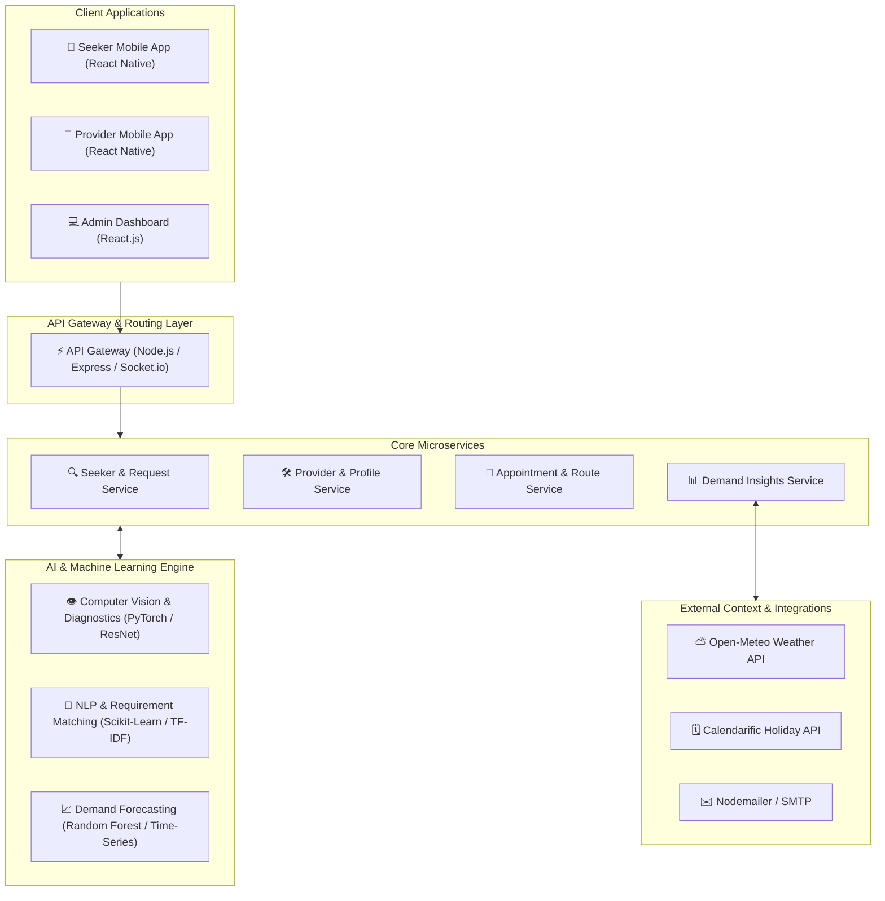

# WorkWave — AI-Powered MicroLocal Service Platform
> **Research Project Code:** R26-SE-020  
> **Repository:** [R26-SE-020-Web-Site](https://github.com/TashmiOshera/R26-SE-020-Web-Site)  
> **Official Showcase Website & Documentation**

[](https://en.wikipedia.org/wiki/HTML5)
[](https://en.wikipedia.org/wiki/CSS)
[](https://developer.mozilla.org/en-US/docs/Web/JavaScript)
[](https://www.python.org/)
[](https://fastapi.tiangolo.com/)
[](https://reactnative.dev/)

---

## 📌 Executive Summary

**WorkWave** is an integrated, AI-driven MicroLocal service marketplace engineered to bridge the accessibility, coordination, and trust gap between local informal micro-entrepreneurs (plumbers, electricians, carpenters, painters, cleaners) and service seekers within localized geographic regions.

Traditional local service platforms suffer from fragmented communication, opaque pricing, unreliable appointment scheduling, and absence of predictive demand insights. WorkWave introduces a unified multi-component architecture combining:
1. **Intelligent Service Discovery & Multimodal Request Diagnostics**
2. **Context-Aware Provider Recommendation & Trust Governance**
3. **Automated Provider Portfolio & Smart Advertisement Generation**
4. **Time-Series Service Demand Forecasting with External Contextual Features**

---

## 🏗️ System Architecture Overview



---

## 🔬 Research Contributions & Key Innovations

### 1. Primary Scientific Contribution
* **Multi-Component Architecture:** Designed and implemented a scalable, fault-tolerant local service marketplace combining computer vision diagnostics, NLP-driven provider matchmaking, and contextual demand forecasting into an integrated lifecycle workflow.
* **Empowering Micro-Entrepreneurs:** Removes technical and marketing barriers for informal service providers through automated profile portfolio synthesis, OCR certificate validation, and smart advertisement generation.

### 2. Next Milestones & Future Work
* Validating integration contracts and shared schemas across all microservices.
* Systematic end-to-end load testing under high concurrency.
* Enhancing traceability of model attribution, bias mitigation, and reported demand forecasting metrics.

---

## ⚡ 9 Core Technical Challenges & Solutions

Detailed in the standalone [Challenges Page](challenges.html):

| # | Challenge | Core Engineering Hurdle | Technical Solution Implemented |
|---|---|---|---|
| **01** | Multimodal Request Intake | Unclear service descriptions & low-quality user photos | Hybrid CV defect recognition + structured NLP prompts for prompt triage |
| **02** | Cold-Start Matching | New providers lack historic reviews and rating metrics | Hybrid collaborative filtering + skill-tag similarity weighting & proximity |
| **03** | Automated Ad Generation | Non-standard service photos and inconsistent branding | Template synthesis engine + automated caption & badge generation |
| **04** | Time-Series Demand Forecasting | Highly erratic booking spikes influenced by external events | Multi-variable Random Forest combining weather, holidays, and localized trends |
| **05** | Distributed Concurrency | Simultaneous booking clashes during peak hours | Pessimistic slot locking + distributed transactional state coordination |
| **06** | Real-Time Sync | Dynamic schedule changes and live GPS updates | Socket.io WebSockets with heartbeat connection recovery & Redis caching |
| **07** | Fraud & Trust Verification | Duplicate provider registrations and fabricated certificates | Tesseract.js OCR credential inspection + perceptual image hashing |
| **08** | Offline Capability | Unstable network connectivity in localized transit | SQLite offline queuing with delta-synchronization upon reconnect |
| **09** | Architecture Scalability | Microservice cross-chatter latency | Lightweight API Gateway routing + decoupled asynchronous event pipelines |

---

## 🛠️ Technology Stack

### Frontend & Mobile
* **Mobile Applications:** React Native (Expo)
* **Web Admin Portal:** React.js
* **Showcase Website:** Semantic HTML5, Vanilla CSS3 (Custom Design System), Modern JavaScript ES6+
* **Icons & Visual Assets:** Font Awesome 6 Pro, Icons8 Authentic Color Graphics, Devicon

### Backend & Microservices
* **Core API Framework:** Node.js, Express.js
* **Machine Learning Microservice:** Python 3.10+, FastAPI, Uvicorn
* **Real-Time Communication:** Socket.io
* **Authentication & Security:** JWT (JSON Web Tokens), Bcrypt password hashing
* **Email & Notifications:** Nodemailer, SMTP

### AI / Machine Learning
* **Computer Vision:** PyTorch, Torchvision, Convolutional Neural Networks
* **Natural Language Processing:** Scikit-learn, TF-IDF Vectorization, Cosine Similarity
* **Time-Series & Regression:** Random Forest Regressor, Pandas, NumPy
* **Optical Character Recognition (OCR):** Tesseract.js

### External APIs
* **Weather Intelligence:** Open-Meteo API
* **Public Calendars & Holidays:** Calendarific API

---

## 👥 Research Team (Group R26-SE-020)

| Name | Student ID | Role | Profiles |
|---|---|---|---|
| **K.M.J.P. Kumarasekara** | IT22112064 | Trainee Software Engineer | [](https://github.com/jeewa-hash) [](https://www.linkedin.com/in/jeewanthi-kumarasekara-99143928a/) |
| **K.A.T. Oshera** | IT22065612 | Trainee Software Engineer | [](https://github.com/TashmiOshera) [](https://www.linkedin.com/in/tashmi-oshera-868490330/) |
| **M.N.U. Silva** | IT22169112 | Trainee Software Engineer | [](https://github.com/nethmiu) [](https://www.linkedin.com/in/nethmiumaya/?isSelfProfile=false) |
| **W.A.C.S. Wijesinghe** | IT22129376 | Trainee Software Engineer | [](https://github.com/chaveenn) [](https://www.linkedin.com/in/chaveen-sewni-wijesinghe/) |

---

## 📅 Project Milestones & Assessment

| Milestone | Target Date | Allocated Weight | Status | Documents / Deliverables |
|---|---|---|---|---|
| **Project Proposal** | March 16, 2026 | 12% | Completed | [Proposal Documents](https://drive.google.com/drive/folders/1lgGaW6Vu-JRZ15jmahZR2x6BYfX3Rv-B?usp=drive_link) |
| **Progress Presentation-1 (PP1)** | May 12, 2026 | 15% | Completed (50% Build) | [PP1 Documents](https://drive.google.com/file/d/1OXTCEsP_riWClib2lxXkumriyzUTIbKj/view?usp=drive_link) |
| **Progress Presentation-2 (PP2)** | September 01, 2026 | 18% | Completed (90% Build) | [PP2 Documents](https://drive.google.com/file/d/1IK7O7Q-dQc-JSxxceD5zrectUZBdyb0S/view?usp=drive_link) |
| **Final Presentation & Viva** | October 21, 2026 | 20% | Completed (100% Build) | [Final Thesis & 4 Sub-Docs](https://drive.google.com/drive/folders/1tJDODSkHKVIW5s1x8e2m7Eh1hO0Wto3V?usp=drive_link) |

---

## 📂 Official Project Documentation

1. **Project Charter:** [Google Drive Document](https://drive.google.com/file/d/195VOMaFr6PDCBF_bRkzH_cRGe9ToHJ9k/view?usp=drive_link)
2. **Proposal Document:** [Google Drive Document](https://drive.google.com/file/d/1c3sQJlBCfnrM2HPZztpfTbbzRtDOSnKj/view?usp=drive_link)
3. **Evaluation Checklists:** [Google Drive Document](https://drive.google.com/file/d/12giA6Fq7ZAM08GNI-V_NlttXA8NzUwwp/view?usp=drive_link)
4. **Final Comprehensive Thesis & Supplementary Reports:** [Google Drive Folder](https://drive.google.com/drive/folders/1tJDODSkHKVIW5s1x8e2m7Eh1hO0Wto3V?usp=drive_link)

---

## 🎥 Project Demonstration & Video Walkthrough

Watch the complete end-to-end research and platform demonstration:
* **YouTube Video:** [WorkWave System Demonstration](https://youtu.be/6OpWNguj5l8)

---

## 🚀 How to Run the Showcase Website Locally

Since the showcase site is built using standards-compliant vanilla web technologies:

1. **Clone the repository:**
   ```bash
   git clone https://github.com/TashmiOshera/R26-SE-020-Web-Site.git
   cd R26-SE-020-Web-Site
   ```

2. **Open with Live Server:**
   * If using VS Code, right-click `index.html` and choose **Open with Live Server**.
   * Alternatively, use Python's built-in HTTP server:
     ```bash
     python -m http.server 5500
     ```
   * Open your browser at: `http://localhost:5500`

---

## 📄 License & Attribution

This research project is developed as part of the Final Year Software Engineering Research Assessment (2026).  
Copyright &copy; 2026 **WorkWave Project Team (Group R26-SE-020)**. All rights reserved.
