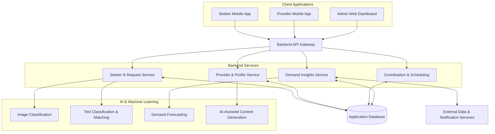

# 🌊 WorkWave — AI-Powered MicroLocal Service Platform

**An AI-driven platform connecting local service seekers with skilled micro-entrepreneurs across Sri Lanka.**

<p align="center">
  
  
  
</p>

<p align="center">
  <a href="https://github.com/TashmiOshera/R26-SE-020-Web-Site">GitHub Repository</a> ·
  <a href="challenges.html">Technical Challenges</a> ·
  <a href="https://youtu.be/6OpWNguj5l8">System Demonstration</a>
</p>

---

## 📌 1. Project Overview

**WorkWave** is an AI-powered micro-local service platform developed as part of the final-year Software Engineering research project **R26-SE-020**.

The platform aims to bridge the gap between local service seekers and informal micro-entrepreneurs by improving service discovery, provider recommendations, communication, and access to local service opportunities.

Traditional local service discovery often relies on informal communication, manual searching, and fragmented online listings. These approaches can make it difficult for users to describe their requirements, identify suitable providers, assess trustworthiness, and coordinate service delivery.

WorkWave addresses these challenges through an integrated platform combining intelligent service discovery, multimodal request analysis, provider recommendation, automated content generation, and data-driven demand insights.

### 🎯 Project Objectives

- Simplify local service discovery through AI-assisted request analysis.
- Support service requests submitted using text and images.
- Recommend relevant service providers using contextual information.
- Help micro-entrepreneurs present their services more effectively.
- Improve communication and coordination between seekers and providers.
- Explore data-driven approaches to understanding local service demand.

## ✨ 2. Key Research Components

| Component | Description |
|---|---|
| 🔍 Intelligent Service Discovery | Analyses service requests and helps identify relevant service categories. |
| 🖼️ Multimodal Request Analysis | Uses text and image inputs to support service identification and request clarification. |
| 🤝 Provider Recommendation | Supports provider matching using service relevance and contextual factors. |
| 📝 AI-Assisted Content Generation | Supports the creation of structured service descriptions and promotional content. |
| 📊 Service Demand Insights | Explores demand patterns and forecasting using historical and contextual information. |

## 🏗️ 3. System Architecture

The proposed architecture separates client applications, backend services, and AI/ML capabilities to support modular development and integration.



*Note: This diagram represents the high-level system architecture. Actual service boundaries and integrations should be verified against the final implementation.*

## 🧠 4. AI & Machine Learning Approach

### Computer Vision

Image classification supports the identification of service-related categories from user-submitted photographs. The research implementation explores convolutional neural network models, including MobileNetV2 and EfficientNetB0.

### Natural Language Processing

Text classification and requirement matching help interpret service descriptions and identify relevant service categories. TF-IDF vectorization and similarity-based techniques can support text representation and matching.

### Provider Recommendation

Provider recommendations can consider multiple factors, including:

- **Service relevance** — how closely the provider's skills match the request.
- **Proximity** — the geographical relationship between seeker and provider.
- **Trust** — available ratings, reviews, and verification information.
- **Availability** — the provider's ability to undertake the requested service.

### Demand Insights

Demand forecasting explores historical service activity and contextual variables to identify patterns that may help inform local service planning.

*Model performance, forecasting results, and integration claims should be reported using verified experimental results from the final research implementation.*

## 🔬 5. Research Contributions & Future Work

### Research Contributions

- **Integrated Service Discovery:** A research-oriented approach to combining request analysis and local service discovery.
- **Multimodal Input:** Exploration of text and image inputs to make service requests easier to express.
- **Context-Aware Recommendations:** Consideration of relevance, location, trust, and availability when recommending providers.
- **Micro-Entrepreneur Support:** AI-assisted tools intended to improve service presentation and accessibility.
- **Demand Intelligence:** Exploration of predictive insights for understanding localized service demand.

### Future Work

- Validate interfaces and shared data schemas across system components.
- Conduct documented end-to-end and integration testing.
- Evaluate AI models using appropriate metrics and representative real-world data.
- Improve recommendation relevance, fairness, and explainability.
- Validate demand forecasting results against suitable baselines.
- Evaluate scalability, response time, reliability, and usability under realistic conditions.

## ⚙️ 6. Technical Challenges & Engineering Approaches

The project addresses a range of technical challenges associated with AI-driven local service platforms.

| No. | Challenge | Engineering Approach |
|:---:|---|---|
| 01 | Multimodal request intake | Combine image classification, text analysis, and guided requirement collection. |
| 02 | Provider cold start | Explore skill similarity and contextual ranking when historical feedback is limited. |
| 03 | Service advertisement creation | Generate structured service descriptions and promotional content. |
| 04 | Demand forecasting | Explore predictive models incorporating historical and contextual features. |
| 05 | Booking concurrency | Validate scheduling constraints and prevent conflicting appointments. |
| 06 | Real-time communication | Use event-driven communication mechanisms where implemented. |
| 07 | Provider trust and verification | Explore identity, credential, and image verification mechanisms. |
| 08 | Unstable connectivity | Investigate offline storage and synchronization strategies where applicable. |
| 09 | Integration and scalability | Validate API contracts, component boundaries, and service communication. |

For a more detailed overview, see the [Technical Challenges page](challenges.html).

## 🛠️ 7. Technology Stack

### Frontend & Client Applications

- React Native with Expo
- React.js
- HTML5
- CSS3
- JavaScript (ES6+)

### Backend & Communication

- Node.js
- Express.js
- REST APIs
- Socket.IO
- JWT-based authentication
- Bcrypt password hashing

### AI & Machine Learning

- Python
- FastAPI
- TensorFlow/Keras-based image classification models
- MobileNetV2
- EfficientNetB0
- Scikit-learn
- TF-IDF and cosine similarity
- Pandas and NumPy

### Data & Integrations

- MongoDB
- Open-Meteo Weather API
- Calendarific Holiday API
- SMTP-based email services

*The listed technologies describe the project stack and research approaches. Individual dependencies and integrations should be confirmed against the final source code.*

## 👥 8. Research Team

**Group ID: R26-SE-020**

| Research Team Member | Student ID | Role | Profiles |
|---|---|---|---|
| K.M.J.P. Kumarasekara | IT22112064 | Trainee Software Engineer | [GitHub](https://github.com/jeewa-hash) · [LinkedIn](https://www.linkedin.com/in/jeewanthi-kumarasekara-99143928a/) |
| K.A.T. Oshera | IT22065612 | Trainee Software Engineer | [GitHub](https://github.com/TashmiOshera) · [LinkedIn](https://www.linkedin.com/in/tashmi-oshera-868490330/) |
| M.N.U. Silva | IT22169112 | Trainee Software Engineer | [GitHub](https://github.com/nethmiu) · [LinkedIn](https://www.linkedin.com/in/nethmiumaya/) |
| W.A.C.S. Wijesinghe | IT22129376 | Trainee Software Engineer | [GitHub](https://github.com/chaveenn) · [LinkedIn](https://www.linkedin.com/in/chaveen-sewni-wijesinghe/) |

## 📅 9. Project Milestones

| Milestone | Date | Weight | Status |
|---|---|---:|---|
| Project Proposal | March 16, 2026 | 12% | Completed |
| Progress Presentation 1 (PP1) | May 12, 2026 | 15% | Completed |
| Progress Presentation 2 (PP2) | September 1, 2026 | 18% | Completed |
| Final Presentation & Viva | October 21, 2026 | 20% | Scheduled |

### 📚 Assessment Documents

- [Project Proposal Documents](https://drive.google.com/drive/folders/1lgGaW6Vu-JRZ15jmahZR2x6BYfX3Rv-B?usp=drive_link)
- [PP1 Documents](https://drive.google.com/file/d/1OXTCEsP_riWClib2lxXkumriyzUTIbKj/view?usp=drive_link)
- [PP2 Documents](https://drive.google.com/file/d/1IK7O7Q-dQc-JSxxceD5zrectUZBdyb0S/view?usp=drive_link)
- [Final Thesis & Supplementary Reports](https://drive.google.com/drive/folders/1tJDODSkHKVIW5s1x8e2m7Eh1hO0Wto3V?usp=drive_link)

## 📖 10. Official Project Documentation

| Document | Link |
|---|---|
| Project Charter | [View Document](https://drive.google.com/file/d/195VOMaFr6PDCBF_bRkzH_cRGe9ToHJ9k/view?usp=drive_link) |
| Research Proposal | [View Document](https://drive.google.com/file/d/1c3sQJlBCfnrM2HPZztpfTbbzRtDOSnKj/view?usp=drive_link) |
| Evaluation Checklists | [View Document](https://drive.google.com/file/d/12giA6Fq7ZAM08GNI-V_NlttXA8NzUwwp/view?usp=drive_link) |
| Final Thesis & Supplementary Reports | [View Folder](https://drive.google.com/drive/folders/1tJDODSkHKVIW5s1x8e2m7Eh1hO0Wto3V?usp=drive_link) |

## 🎥 11. System Demonstration

Watch the project demonstration to explore the WorkWave platform and its research components.

**[▶ Watch the WorkWave System Demonstration on YouTube](https://youtu.be/6OpWNguj5l8)**

## 🚀 12. Run the Showcase Website Locally

The repository contains the static showcase website built using HTML, CSS, and JavaScript.

### Prerequisites

- Git
- A modern web browser
- Visual Studio Code with Live Server, or Python

### Step 1 — Clone the repository

```bash
git clone https://github.com/TashmiOshera/R26-SE-020-Web-Site.git
cd R26-SE-020-Web-Site
```

### Step 2 — Navigate to the website directory

```bash
cd R26-SE-020_Web_Site
```

### Step 3 — Start the website

**Option A: Visual Studio Code**

1. Open the website folder in VS Code.
2. Open `index.html`.
3. Right-click the file and select **Open with Live Server**.

**Option B: Python HTTP server**

```bash
python -m http.server 5500
```

Open the following address in your browser:

```text
http://localhost:5500
```

> These instructions apply to the static showcase website. Running the mobile applications, backend services, or ML services requires their respective dependencies and configuration.

## 📁 13. Repository Structure

```text
R26-SE-020-Web-Site/
├── README.md
└── R26-SE-020_Web_Site/
    ├── index.html
    ├── old_index.html
    ├── challenges.html
    ├── old_style.css
    ├── css/
    │   └── style.css
    ├── images/
    │   ├── hero-bg.jpg
    │   └── light-bg.jpg
    └── img/
        ├── chaveen.jpg
        ├── domain-ai.png
        ├── hero.jpg
        ├── kumarasekara.png
        ├── nethmi.png
        ├── oshera.jpg
        └── system-architecture.jpg
```

## 📄 14. License & Attribution

WorkWave is an academic research project developed as part of the final-year Software Engineering research assessment at the Sri Lanka Institute of Information Technology (SLIIT).

**Research Project Code:** R26-SE-020

**Copyright © 2026 WorkWave Project Team.**

All rights reserved unless otherwise stated. Third-party libraries, tools, and resources remain subject to their respective licenses.

---

<p align="center">
  <strong>WorkWave — Connecting Local Needs with Local Talent.</strong>
  <br/>
  <sub>Research • Innovation • Intelligent Service Discovery</sub>
</p>